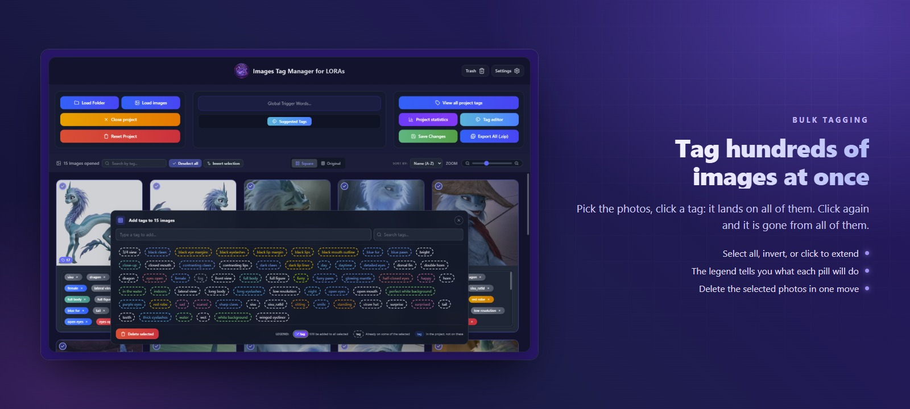
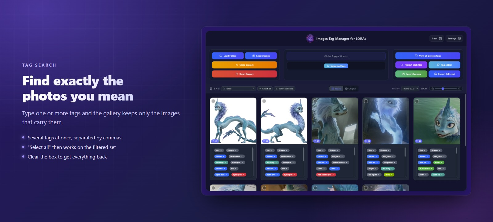
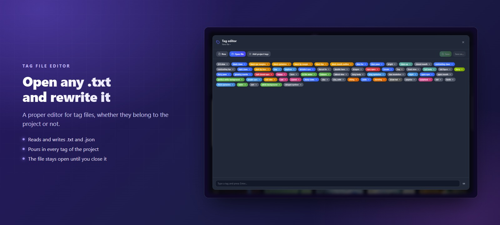
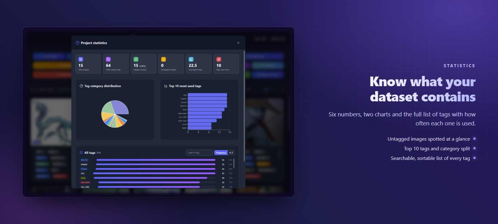
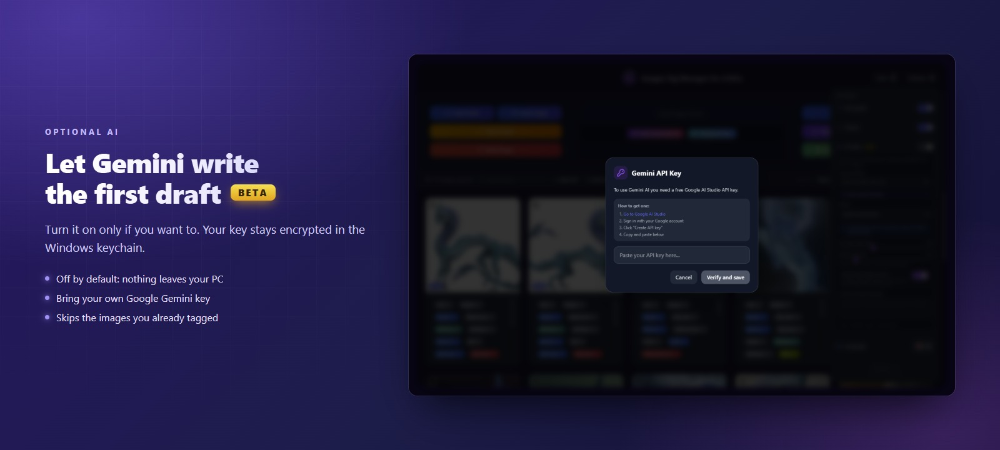
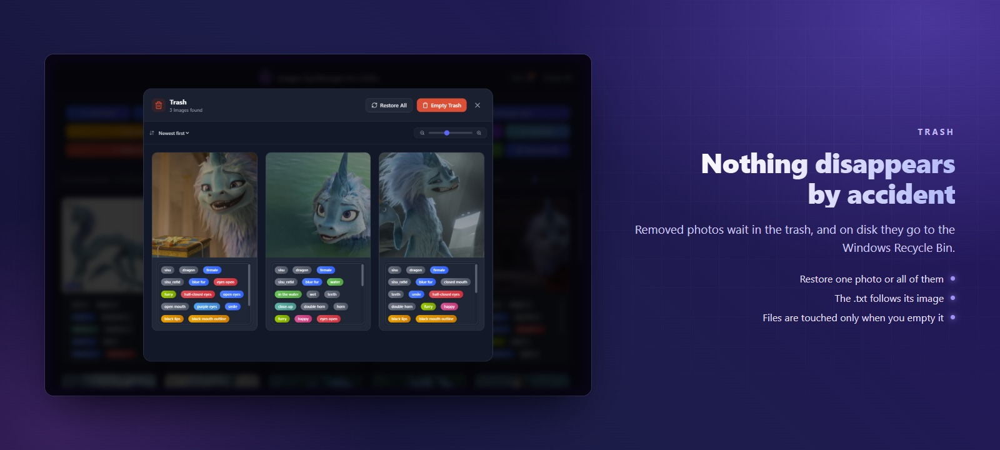
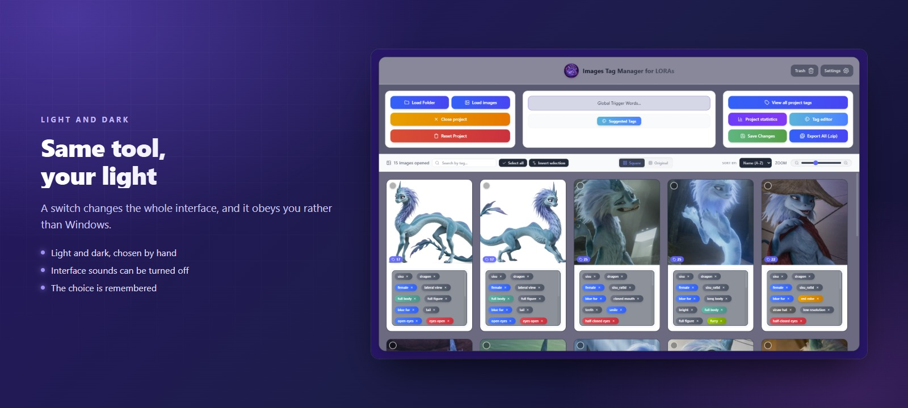
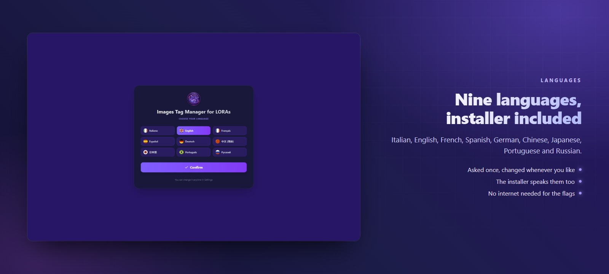

<div align="center">
  

  <br /><br />

  [](#-download)
  [](https://reactjs.org/)
  [](https://vitejs.dev/)
  [](https://www.electronjs.org/)
  [](https://tailwindcss.com/)
</div>

---

## 📖 What it is

**Images Tag Manager for LORAs** is a desktop tool for preparing image datasets for **LoRA / Kohya_SS / Stable Diffusion** training.

You point it at a folder, it reads every image together with its `.txt` tag file, and it lets you edit those tags — one photo at a time or hundreds at once — then writes them straight back to disk in the same format.

It runs entirely on your machine and sends **no telemetry**. Cloud AI tagging is **optional and off by default**: images reach Google only if you switch the AI on and supply your own API key.

---

## ✨ What it does



















Plus: curated tag suggestions by category, global trigger words, project-wide tag manager, NSFW `+18` badges, ZIP / JSON / TXT export, copy & paste tags between photos, undo & redo, and a crash-recovery backup.

---

## 📥 Download

Grab the latest **portable** or **installer** build from the [Releases](../../releases) page. No Node.js, no setup — the portable one just runs.

> The build is **not code-signed** (a certificate costs hundreds of euros a year), so Windows SmartScreen may say *"unknown publisher"*. That is expected: click **More info → Run anyway**. The installer explains this on its welcome page.

### Where your data lives

Settings, cache and logs go to `%APPDATA%\images-tag-manager` — never next to the executable, in both the portable and the installed version. **Your images and `.txt` files are never copied there**: they stay where they are, and are only rewritten when you press Save.

---

## 🤖 AI tagging (optional · Beta)

AI is **off by default**. Enable the AI Tools section in Settings, save a valid Gemini API key, and the app can tag images in booru style suitable for Kohya / sd-scripts (comma-separated lowercase tags), optionally steered by a custom prompt. One model only — **Gemini 3.6 Flash** — no captioning, no model picker.

Get a key at [Google AI Studio](https://aistudio.google.com/app/apikey) → *Create API key*. The app verifies it with a tiny test call before saving, then encrypts it in the OS keychain via Electron `safeStorage`.

"Auto-tag all" paces its requests to stay under Google's free-tier rate limit, can skip already-tagged photos, and can be cancelled mid-batch.

---

## 🔒 Security

*   The Electron renderer runs with `contextIsolation: true`, `nodeIntegration: false`, `sandbox: true`, and a minimal IPC bridge (`electron/preload.cjs`).
*   A strict Content-Security-Policy is applied both by the `index.html` meta tag and by the production session headers in `electron/main.cjs`. `connect-src` allows **only** `generativelanguage.googleapis.com`; everything else is blocked.
*   The Gemini API key is stored encrypted through Electron `safeStorage` (OS keychain) — never in plain `localStorage`, never inside the bundle.
*   File paths reaching the disk IPC are validated (no UNC, no `..`, no relative paths), and names written to disk or into ZIP archives are sanitized against path traversal and Windows reserved names.
*   A React `ErrorBoundary` shows a recovery screen instead of a blank window.

---

## 🛠️ Build from source

Requires [Node.js](https://nodejs.org/) 18 or newer.

```bash
npm install
```

Run it in the browser for development:

```bash
npm run dev
```

Run it as a real desktop app:

```bash
npm run electron:dev
```

Produce the portable `.exe` and the installer (both land in `release/`):

```bash
npm run electron:build
```

### Regenerating the images of this page

The cover and the feature cards above are generated, not hand-made. With the dev server running:

```bash
npx electron scripts/make-readme-shots.mjs --folder "C:\path\to\a\tagged\dataset"
```

```bash
npx electron scripts/make-cover.mjs
```

```bash
npx electron scripts/make-feature-cards.mjs
```

Without `--folder` the first script draws its own sample images, so it works on any machine.

---

## 🧰 Tech stack

*   **Frontend**: React 19, TypeScript, Vite 6
*   **Styling**: Tailwind CSS 4
*   **Icons**: Lucide React
*   **Desktop**: Electron (hardened) + Electron Builder, NSIS installer in 9 languages
*   **AI**: `@google/genai` (Gemini API)
*   **Utilities**: JSZip (archives), Recharts (statistics charts)

---

## 📝 License & credits

Developed and designed by **xXIlRizzoXx**.

The screenshots on this page show a sample dataset used only to illustrate the interface; the characters depicted belong to their respective rights holders.
