

  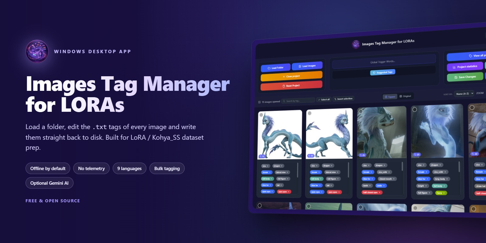

    

  
  
  
  
  

  The screenshots on this page show a sample dataset used only to illustrate the interface; the characters depicted belong to their respective rights holders.

---

## 📖 What it is

**Images Tag Manager for LORAs** is a desktop tool for preparing image datasets for **LoRA / Kohya_SS / Stable Diffusion** training.

You point it at a folder, it reads every image together with its `.txt` tag file, and it lets you edit those tags — one photo at a time or hundreds at once — then writes them straight back to disk in the same format.

It runs entirely on your machine and sends **no telemetry**. AI tagging is **optional and off by default**: images reach Google only if you switch the AI on and supply your own API key, and reach another AI only if you switch on the MCP server and connect that AI yourself.

---

## ✨ What it does

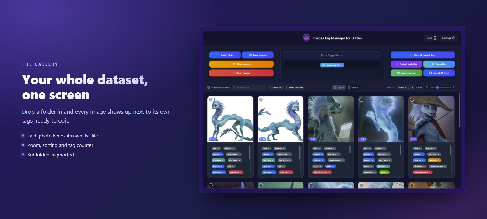

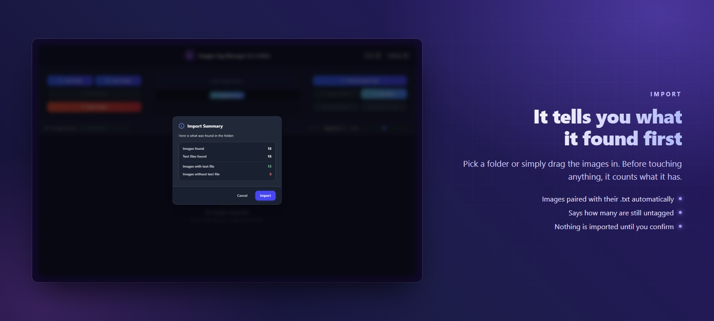

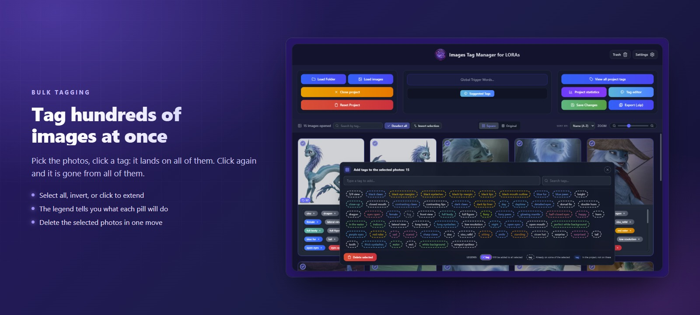

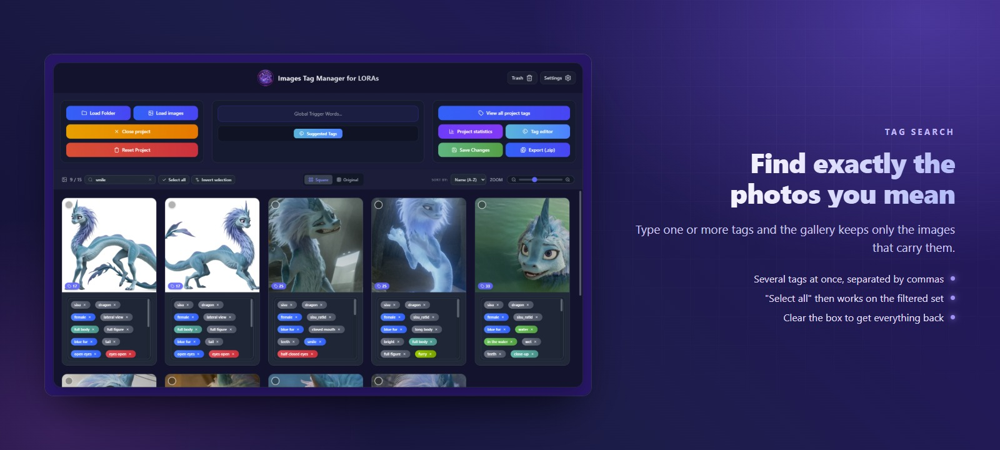

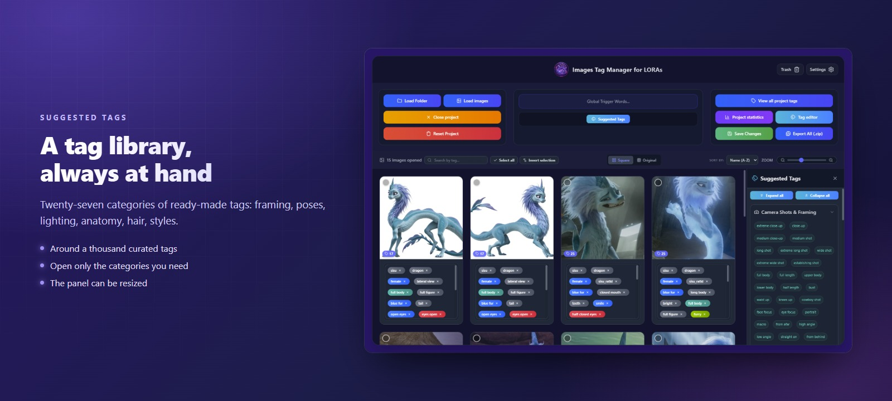

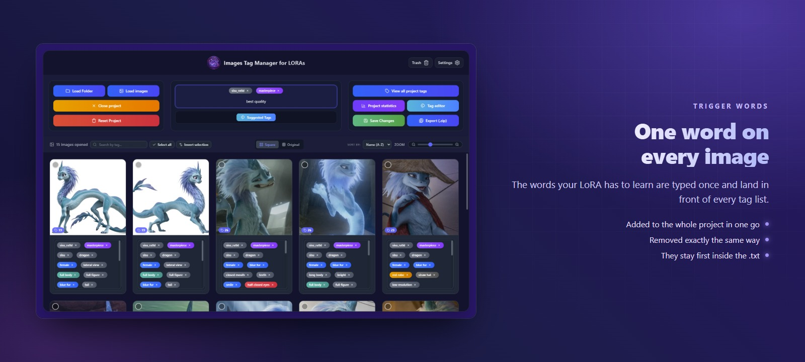

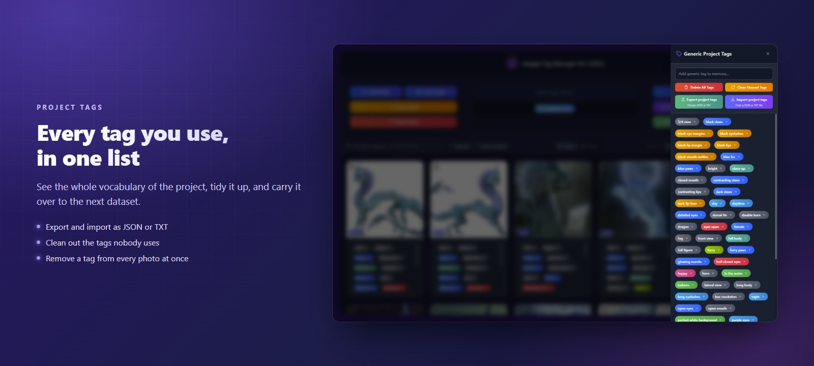

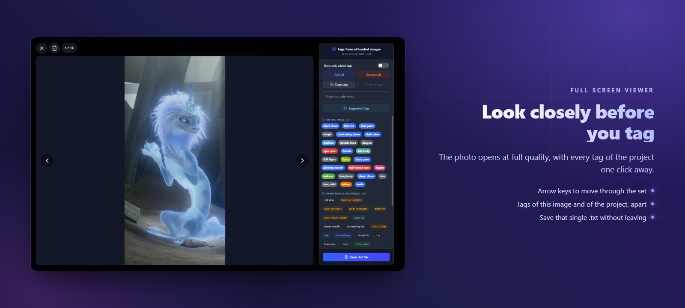

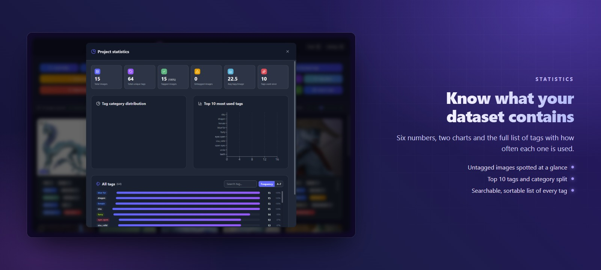

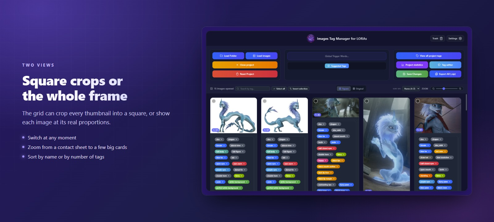

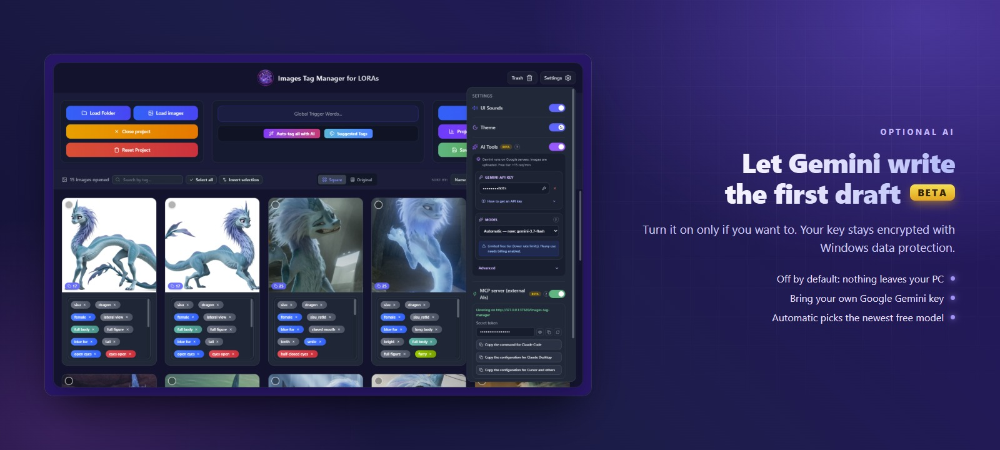

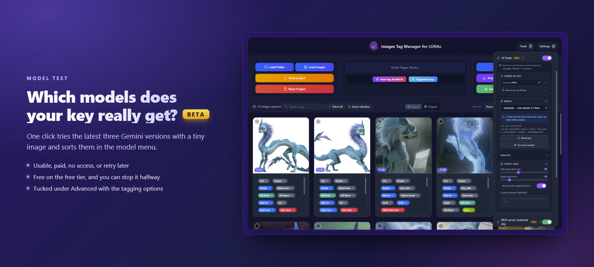

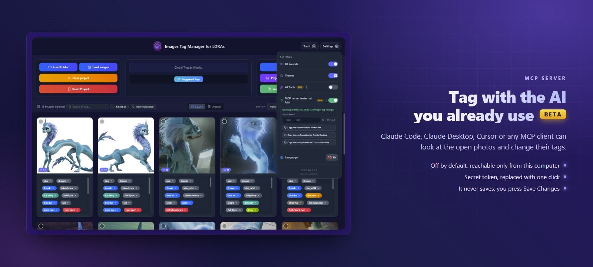

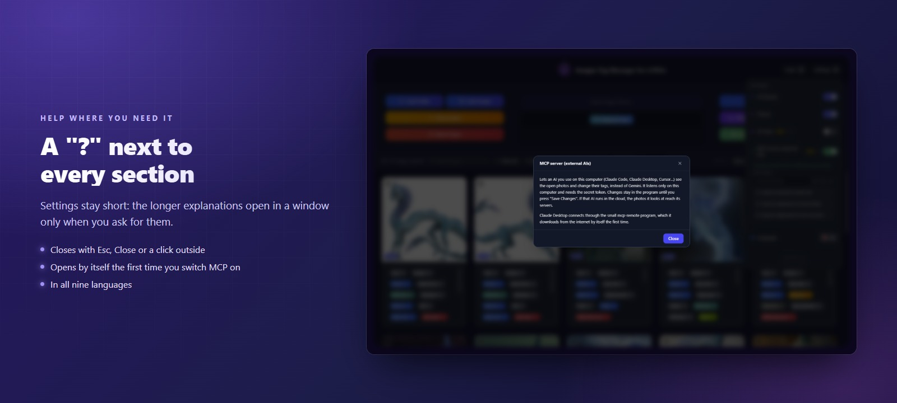

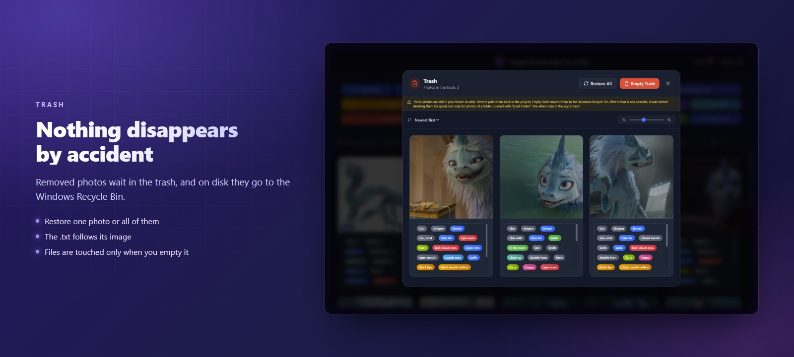

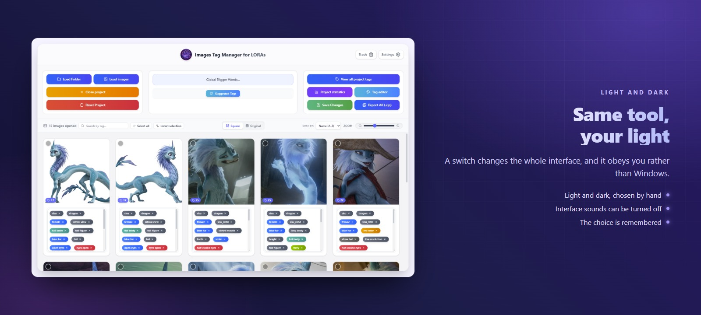

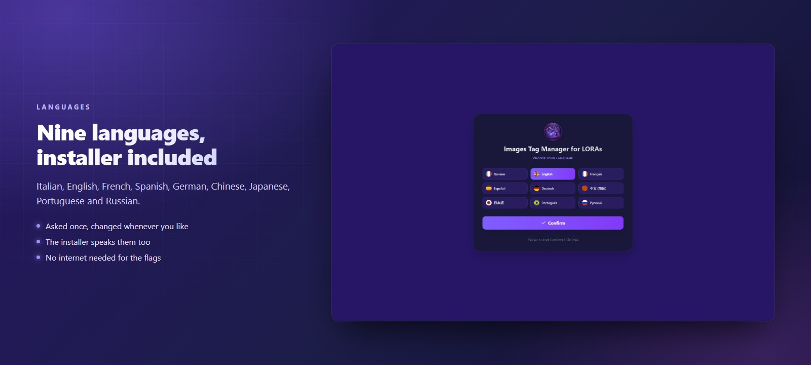

Plus: NSFW `+18` badges, ZIP / JSON / TXT export, copy & paste tags between photos, undo & redo, tag names translated on hover, and a crash-recovery backup that survives a power cut.

---

## 📥 Download

Grab the latest **portable** or **installer** build from the [Releases](../../releases) page. No Node.js, no setup — the portable one just runs.

> The build is **not code-signed** (a certificate costs hundreds of euros a year), so Windows SmartScreen may say *"unknown publisher"*. That is expected: click **More info → Run anyway**. The installer explains this on its welcome page.
>
> Some antivirus programs (Avast, for example) may stop an unknown program the first time it runs, and Windows then says *"Windows cannot access the specified device, path, or file"*. Add the downloaded file to the antivirus exceptions (or restore it from its quarantine) and run it again.

### Where your data lives

Settings, cache and logs go to `%APPDATA%\images-tag-manager` — never next to the executable, in both the portable and the installed version. **Your images and `.txt` files are never copied there**: they stay where they are, and are only rewritten when you press Save.

> **Tip:** the first time you work on a folder, keep a copy of its images and `.txt` files. The app only rewrites them when you press Save, but a backup costs nothing.

---

## 🤖 About the AI

The AI is **optional and off by default** — with it off, nothing is sent to Google. Your images and tags leave your computer only if you switch the AI on, or if you switch on the MCP server and connect an AI assistant that works in the cloud (see below).

If you want it, get a free key at [Google AI Studio](https://aistudio.google.com/app/apikey) and paste it into Settings. The app checks the key works before saving it, then keeps it **encrypted with Windows' own data protection**, tied to your Windows account, in the app's folder under %APPDATA%: it is never stored in plain text. Only the images you actually ask it to tag are sent, and you can stop a batch halfway. Only the picture itself goes: the hidden details a photo file carries (GPS position, camera serial number, author's name, editing history) are removed first. JPEG, PNG, WebP and HEIC photos are sent in their own format, and GIF, BMP, AVIF and the other formats the app can convert are sent as a PNG copy of their pixels (a JPEG copy when the PNG would be too big). TIFF and SVG files (and damaged ones) cannot be converted, so they are never sent and cannot be tagged with AI.

The model is picked for you: on **Automatic** the app uses the newest model of Google's free line, tries it before switching and tells you when it changes. To do that, with the AI on it checks Google's list of models at most once a day. Prefer one model? Choose it in Settings and it stays fixed, unless Google retires it or takes it off the free tier: then the app switches to the newest free model that works, tells you, and goes back to Automatic. The default pace (14 requests a minute) stays inside Google's free tier. The Speed slider goes up to 60 a minute: use it only if your key allows that much, because on the free tier Google refuses the requests over its limit (an error, not a bill) and those photos stay untagged.

Not sure which models your key can really use? **Test recent models** (under **Advanced**, together with the tagging options) tries, with a tiny image, the models of the latest three Gemini versions that Google lists for your key, and sorts them in the model menu: usable, paid, no access, not suitable for tagging photos, or to retry later. It can take several minutes (up to a minute for each slow model) and you can stop it halfway. On the free tier it costs nothing; with billing enabled, tests of paid models are charged, usually less than one US cent each and a few cents for models that think at length.

---

## 🔌 Tagging with an AI you already use (MCP)

Settings has a built-in **MCP server**, **off by default**. Switch it on and an AI assistant on your computer (Claude Code, Claude Desktop, Cursor or any other MCP client) can list the open photos, look at them and change their tags, instead of Gemini.

*   It listens **only on your own computer** (`127.0.0.1`), never on the network, and asks for a **secret token**; **Create a new token** locks out every AI connected with the old one. Claude Code then refuses to add the server a second time under the same name: first run `claude mcp remove images-tag-manager`, then paste the new command.
*   The AI sees only the photos open in the app. Each photo it looks at is a copy at most 1024 px on its longest side, redrawn so that the hidden details of the file (GPS position, camera serial number, author) do not go with it. What it sees then goes wherever that AI goes: an assistant that runs in the cloud sends it to its own servers.
*   **It never saves.** Tags changed by the AI show up in the app as unsaved changes: review them, and the `.txt` files are written only when you press **Save Changes**.
*   With the server on, a small **MCP light** next to **Trash** shows its state: green listening, yellow while an AI is working, red if it could not start. Click it for the address, the token and the ready-made configurations. When the AI has changed some tags and then goes quiet for 30 seconds, the app plays a sound and tells you how many photos are waiting to be saved.
*   For Claude Code and other clients that read skills, [`skills/lora-dataset-tagging`](skills/lora-dataset-tagging/SKILL.md) teaches the AI a careful tagging method for LoRA datasets: it looks at every photo, asks what the subject is, reuses your project's tags and leaves saving to you. Copy the folder into `~/.claude/skills/` to use it.
*   Settings gives you the ready-made command or configuration to copy for Claude Code, Claude Desktop and the others. Claude Desktop connects through the small `mcp-remote` program, so the computer needs [Node.js](https://nodejs.org) (free; it brings the `npx` command); after that Claude Desktop downloads `mcp-remote` from the internet by itself the first time. Claude Code and Cursor don't need Node.js.

---

## 🔒 Privacy

*   **No telemetry, no accounts, no auto-update.** The app can tell you when a new version is out, but only if you want it to: it asks you once, the check stays off unless you say yes, and then at startup it reads only the latest version number from GitHub.
*   **Only two addresses are ever contacted**: Google, and only with the AI switched on; GitHub, and only if you said yes to the version check. The app's window can reach nothing but Google, and the version check is the only other connection the program makes. The MCP server, if you switch it on, only accepts connections from programs on your own computer; what those programs do with the photos is up to them.
*   **Your API key is never stored in clear text** and is not inside the download.
*   **Your files stay yours**: images and `.txt` are read where they are and rewritten only when you save. **Move to Trash** only sets a photo aside in the app's own trash: its files stay in your folder. They go to the Windows Recycle Bin when you press **Empty Trash** (or **Delete from Disk** on a single photo in the trash), and **Undo the emptying** puts the last emptying back while the project is still open and the Recycle Bin still has the files. Network folders and removable drives (USB sticks, SD cards) usually have no Recycle Bin, some disks have it turned off (or too small for a photo), and sometimes the app cannot tell where a file sits on disk: then it asks a second time, says the removal is final, and only deletes if you confirm. That second step works through a folder opened with **Load Folder** or dropped on the window: photos loaded one by one or dragged in loose from such a drive stay in the app's trash, and the app tells you to open their folder with **Load Folder** (or drop it on the window) or to delete them in File Explorer. For a network folder whose address starts with `\\` (for example `\\server\share`), opening or dropping the folder is not enough: delete those photos in File Explorer.

---

## 🤝 Ideas, and a hand with the languages

This app was built by one person, around one way of working. If yours is different, that is worth hearing — **[tell us what would help](../../issues/new?template=idea.yml)**. Half-formed ideas are fine; describing what slows you down is more useful than describing a solution.

### The translations need native speakers

The interface speaks nine languages, but only **Italian and English were written by someone who actually speaks them**. The other seven are honest attempts, and attempts have accents: a word that is technically right but sounds wrong, a sentence too long for its button, a tone that lands oddly.

If something reads badly in your language, **[say so here](../../issues/new?template=translation.yml)** — what it says now, what it should say. You do not need to know how to program, and a single sentence is a perfectly good contribution.

One part is deliberately still untranslated: the **dictionary of ~1050 suggested tags** and its 27 category names exist only in Italian and English. Machine-translating a thousand tags would produce plausible nonsense, so it has been left alone until real speakers can look at it. If you are willing to take on a slice of it in French, Spanish, German, Chinese, Japanese, Portuguese or Russian, open an issue and say which language — even a hundred tags is progress.

Bugs go **[here](../../issues/new?template=bug.yml)**. If tag files were ever changed or lost without being asked to, that one jumps the queue.

---

## 📝 Credits

Developed and designed by **xXIlRizzoXx**. Released under the [MIT License](LICENSE).

   
  
   
  <b>Made in Italy</b> &nbsp;·&nbsp; built with the help of <a href="https://claude.com/claude-code">Claude Code</a>
    

